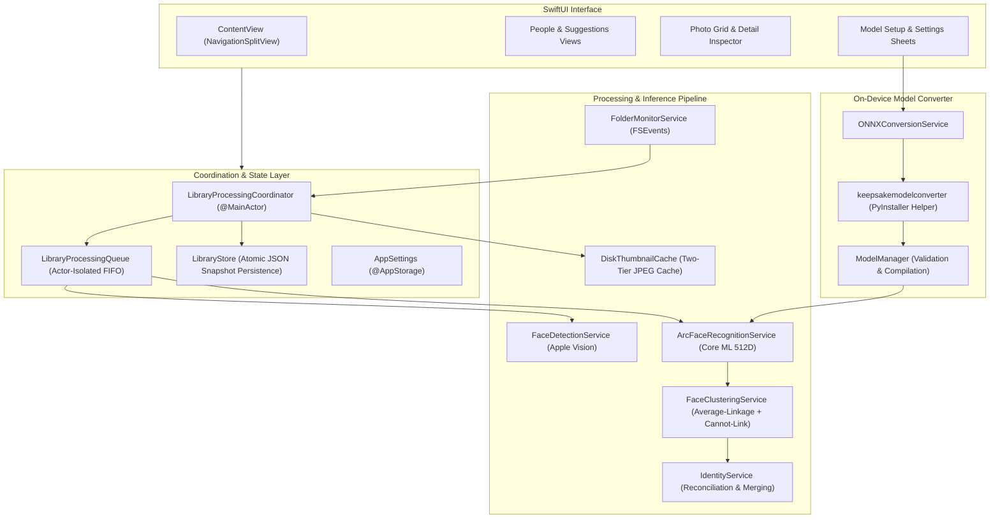

# KeepSake 📸

> **Native, Private, On-Device Face Recognition & Photo Organization for macOS**

KeepSake is a high-performance macOS photo management application that detects, indexes, and clusters faces directly on your Mac. Using Apple Vision for face detection, Core ML for neural feature extraction, and constrained hierarchical clustering, KeepSake organizes personal photo libraries into people and events with zero cloud dependency.

---

## Download for macOS

KeepSake is distributed as a universal standalone disk image (`.dmg`) for macOS:

* 📦 **[Download KeepSake for macOS (DMG)](dist/KeepSake.dmg)**
* 🚀 **[GitHub Releases & Release Notes](https://github.com/vikramaditya7z/keepsake-f/releases)**

**Verified Release DMG Checksum:**
```
SHA-256: 89daac3800920da97b0a1a9356279c15388127822c27c446df857443fd6354a4
```

---

## macOS Security Warning: “KeepSake” Not Opened

When launching KeepSake for the first time after downloading and installing from the DMG, macOS Gatekeeper may block the application and display:

> **“KeepSake” Not Opened**  
> Apple could not verify “KeepSake” is free of malware that may harm your Mac or compromise your privacy.

### Why this happens

The current v1.0.0 release of KeepSake is distributed independently and is **not signed or notarized with an Apple Developer ID**. Because Apple's automated notarization service has not inspected the executable, macOS Gatekeeper blocks opening by default. This security alert is standard macOS behavior for unnotarized software downloaded from the internet and does not by itself establish that the application contains malware. However, Apple has not verified KeepSake, and the developers do not claim that Apple has validated the software.

For official information on macOS app verification, see Apple's documentation:  
👉 [Apple Support: Safely open apps on your Mac](https://support.apple.com/en-in/102445)

### How to open KeepSake

If you downloaded KeepSake directly from the [official GitHub repository](https://github.com/vikramaditya7z/keepsake-f) and trust the application, you can use one of the following macOS override methods:

#### Method 1 — Open Anyway in Privacy & Security (Recommended)
1. On the Gatekeeper warning dialog, click **Done** (or **Cancel**).
2. Open **Apple menu () → System Settings → Privacy & Security**.
3. Scroll down to the **Security** section.
4. If macOS displays a message stating *“KeepSake was blocked from use because it is not from an identified developer”*, click **Open Anyway**.
5. Authenticate with your Mac password or Touch ID when prompted, and confirm the action.

> [!NOTE]
> The **Open Anyway** button is typically available for about an hour after attempting to open the app. This option may not appear in every situation. If macOS reports that the application is damaged, explicitly warns of detected malware, or does not offer the expected override, **stop** and do not attempt to bypass security checks.

#### Method 2 — Open using Finder
1. Open **Finder** and navigate to your `/Applications` folder (or the directory containing `KeepSake.app`).
2. **Control-click** (or right-click) `KeepSake.app` and select **Open** from the context menu.
3. If macOS presents an alert asking for confirmation to open the application, review the prompt and click **Open** only if you trust the download.

> [!NOTE]
> Depending on your version of macOS (such as macOS 15 Sequoia and newer), Finder context-menu overrides may not be offered and will redirect you to the **Privacy & Security** settings panel described in Method 1.

### Security Best Practices
- **Official Source Only**: Download KeepSake exclusively from the [official GitHub repository](https://github.com/vikramaditya7z/keepsake-f) or its [verified releases](https://github.com/vikramaditya7z/keepsake-f/releases). Never download builds from untrusted third-party sites.
- **Overrides are User Decisions**: Overriding a Gatekeeper warning tells macOS to bypass automated policy; an override is not proof or verification that an app is safe.
- **Do Not Disable Gatekeeper Globally**: Never run commands to turn off macOS Gatekeeper globally (such as `spctl --master-disable`) or indiscriminately remove quarantine attributes from unknown files.
- **Notarization Status**: The current release has not been notarized by Apple.

---

## First-Time Setup Guide

Follow these six simple steps to get started with KeepSake:

### Step 1: Install KeepSake
1. Download `KeepSake.dmg`.
2. Double-click the DMG to open it.
3. Drag **KeepSake.app** into your **Applications** folder shortcut.
4. Eject the disk image.

### Step 2: Launch the App
Open **KeepSake.app** from `/Applications`. If macOS displays a security warning, follow the steps in the [macOS Security Warning](#macos-security-warning-keepsake-not-opened) section above.

### Step 3: Choose Your Photo Library
When the app opens, click **Choose Folder** (or click the **+** button in the sidebar) and select any directory containing your photos (e.g. `~/Pictures` or an external drive). KeepSake accesses folders strictly with security-scoped bookmarks without modifying, moving, or re-encoding your original photos.

### Step 4: Set Up the Face Recognition Model
To recognize and cluster people across photos, KeepSake uses a MobileFaceNet ArcFace neural network. Because model weights are third-party research artifacts subject to an academic non-commercial license, users must independently obtain the weights and comply with the applicable model license.

On first launch, KeepSake displays the **Model Setup** sheet:

#### Option A: Automatic Local ONNX Conversion (Recommended)
1. Download `buffalo_s.zip` from the official [InsightFace v0.7.0 Release](https://github.com/deepinsight/insightface/releases/tag/v0.7).
2. Unzip `buffalo_s.zip` and locate `w600k_mbf.onnx`.
3. In KeepSake's setup window, click **Choose ONNX Model…** and select `w600k_mbf.onnx`.
4. KeepSake converts the ONNX model locally using its bundled on-device converter, validates input/output tensors ($1 \times 3 \times 112 \times 112 \to 512\text{D}$), compiles it to Core ML, and installs it automatically into your Application Support directory.

#### Option B: Manual Core ML Import
If you already have a compiled `.mlpackage` or `.mlmodelc`, click **Import Core ML Model…** or configure it anytime under **Settings** (`Cmd + ,`) → **Model** tab.

### Step 5: Automatic Scanning & Indexing
Once the model is installed, KeepSake automatically:
1. Discovers image files (`.jpg`, `.jpeg`, `.heic`, `.png`, `.tiff`).
2. Detects facial bounding boxes using Apple Vision.
3. Generates 512-dimensional face embeddings via Core ML.
4. Performs constrained average-linkage clustering.

### Step 6: Review & Organize People
- **People Gallery**: Browse identified individuals with representative face avatars.
- **Naming**: Click on any person to assign names or merge identities.
- **Suggestion Queue**: Review candidate face matches with high confidence and accept or reject them with a single click.

### Troubleshooting & FAQs

* **Model conversion reports invalid dimensions or fails:** Ensure you selected `w600k_mbf.onnx` extracted from `buffalo_s.zip` (input tensor shape: $1 \times 3 \times 112 \times 112 \to 512\text{D}$). KeepSake validates tensor shapes prior to Core ML compilation.
* **macOS Gatekeeper blocks opening:** Follow the [macOS Security Warning](#macos-security-warning-keepsake-not-opened) instructions. In **System Settings → Privacy & Security**, click **Open Anyway**.
* **Photos folder permission issues:** When prompted by macOS, grant KeepSake access to your selected photos directory. You can verify permissions under **System Settings → Privacy & Security → Files and Folders**.
* **Model setup re-prompted on launch:** If model setup appears again, verify that `~/Library/Application Support/KeepSake/Models/active_model.mlmodelc` exists and has not been moved or deleted.

---

## Key Features

- **🔒 100% On-Device & Private**: Zero network connections, zero telemetry, zero analytics. Your personal photos, embeddings, and metadata never leave your Mac.
- **⚡ Native Apple Silicon & Intel Universal**: Built in Swift and SwiftUI, leveraging Apple Neural Engine (ANE), Metal GPU, and Accelerate framework.
- **🚀 Memory-Optimized Pipeline**: Efficient RAM profile with bounded worker concurrency, cooperative cancellation, integer-indexed graph clustering, and scoped autorelease pools capable of indexing thousands of photos while keeping memory well under control.
- **🧠 512-Dimensional Deep Embeddings**: Accurate face representation using MobileFaceNet ArcFace embeddings.
- **🚫 Cannot-Link Constraint Enforcement**: Two faces detected within the same photo are mathematically prohibited from merging into the same person cluster, preventing false positive conflations.
- **🖼️ Sharp, Orientation-Correct Thumbnails**: High-performance two-tier disk cache preserving EXIF orientation tags and rendering crisp Retina thumbnails.
- **🔄 Live Folder Monitoring**: Uses FSEvents to track added, modified, or deleted photos in real time.
- **💾 Safe, Isolated Storage**: Atomic JSON snapshots ensure library indices survive app crashes or power loss without database corruption.

---

## Architecture

KeepSake is built with a modular, service-oriented Swift architecture adhering to clean separation of concerns and Swift concurrency (`async`/`await` and `actor` isolation).



---

## Privacy & Local Data Storage

KeepSake is strictly local-first. All application state is stored inside standard macOS application support directories:

| Component | Path | Description |
| :--- | :--- | :--- |
| **Library Index** | `~/Library/Application Support/KeepSake/library_index.json` | Atomic JSON snapshot of photos, detected faces, embeddings, and identity clusters. |
| **Installed Model** | `~/Library/Application Support/KeepSake/Models/` | Compiled Core ML face recognition package (`buffalo_s.mlpackage` / `.mlmodelc`). |
| **Thumbnail Cache** | `~/Library/Caches/com.keepsake.KeepSake/Thumbnails/` | JPEG cached thumbnails at $160\text{px}$ and $400\text{px}$ for instantaneous scrolling. |
| **Preferences** | `~/Library/Preferences/com.keepsake.KeepSake.plist` | User display and scan options managed via standard `UserDefaults`. |

Your original photos are **never** copied, modified, tagged, or relocated.

---

## System Requirements

- **Operating System**: macOS 14.0 (Sonoma) or later.
- **Hardware**:
  - Apple Silicon Mac (M1/M2/M3/M4) recommended for Apple Neural Engine acceleration.
  - Intel Mac running macOS 14.0+ supported via CPU and Metal GPU inference.
- **Build Tools** (for developers): Xcode 15.0 or later with macOS 14 SDK.

---

## Developer & Build Instructions

### 1. Clone Repository

```bash
git clone https://github.com/vikramaditya7z/keepsake-f.git
cd keepsake-f
```

### 2. Build Release Application

```bash
xcodebuild \
  -project KeepSake.xcodeproj \
  -scheme KeepSake \
  -configuration Release \
  -derivedDataPath ./build/DerivedData \
  build
```

The resulting `KeepSake.app` will be in:
`build/DerivedData/Build/Products/Release/KeepSake.app`

### 3. Run Test Suite

Run the full suite of automated unit and integration tests:

```bash
xcodebuild \
  -project KeepSake.xcodeproj \
  -scheme KeepSakeTests \
  -derivedDataPath ./build/DerivedData \
  test
```

### 4. Create Distributable DMG

Package the built Release app into a distributable disk image:

```bash
bash build/scripts/create_dmg.sh
```

This creates `dist/KeepSake.dmg` containing `KeepSake.app` and a convenient drag-and-drop `/Applications` folder shortcut.

---

## Licensing & Acknowledgments

- **KeepSake Application Code**: Released under the [MIT License](LICENSE).
- **Third-Party Open-Source Components**: KeepSake bundles runtime dependencies including `onnx2coreml`, `coremltools`, `onnx`, `numpy`, `attrs`, and Python. Full notices and license texts are documented in [THIRD_PARTY_NOTICES.md](THIRD_PARTY_NOTICES.md).
- **Face Recognition Model Architecture**: Based on the MobileFaceNet / ArcFace algorithms developed by the [InsightFace Project](https://github.com/deepinsight/insightface). Checkpoint model weights (`buffalo_s` / `w600k_mbf.onnx`) are separate third-party research artifacts subject to the original creators' non-commercial academic license and are not hosted or distributed within this repository.
