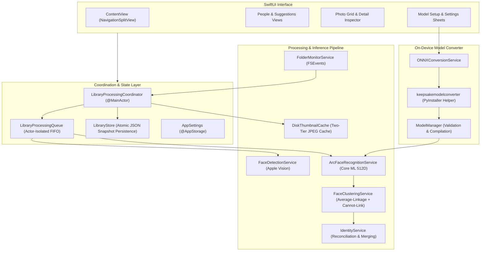

# KeepSake 📸

> **Native, Private, On-Device Face Recognition & Photo Organization for macOS**

KeepSake is a high-performance macOS photo management application that detects, indexes, and clusters faces directly on your Mac. Using Apple Vision for face detection, Core ML for neural feature extraction, and constrained hierarchical clustering, KeepSake organizes personal photo libraries into people and events with zero cloud dependency.

---

## Download for macOS

KeepSake is distributed as a universal standalone disk image (`.dmg`) for macOS:

* 📦 **[Download KeepSake for macOS (DMG)](dist/KeepSake.dmg)**
* 🚀 **[GitHub Releases & Release Notes](https://github.com/vikramaditya7z/keepsake-f/releases)**

> [!NOTE]
> **macOS Gatekeeper Notice**: Because KeepSake is independently distributed without an Apple Developer Program certificate, macOS Gatekeeper may present an *"unidentified developer"* prompt upon initial launch.
>
> To open KeepSake:
> 1. Right-click (or Control-click) **KeepSake.app** in your `/Applications` folder.
> 2. Select **Open** from the context menu, then click **Open** in the dialog.
> 3. Alternatively, open **System Settings → Privacy & Security** and click **Open Anyway**.

---

## First-Time Setup Guide

Follow these six simple steps to get started with KeepSake:

### Step 1: Install KeepSake
1. Download `KeepSake.dmg`.
2. Double-click the DMG to open it.
3. Drag **KeepSake.app** into your **Applications** folder shortcut.
4. Eject the disk image.

### Step 2: Launch the App
Open **KeepSake.app** from `/Applications` (following the Gatekeeper notice above if prompted).

### Step 3: Choose Your Photo Library
When the app opens, click **Choose Folder** (or click the **+** button in the sidebar) and select any directory containing your photos (e.g. `~/Pictures` or an external drive). KeepSake accesses folders strictly with security-scoped bookmarks without modifying, moving, or re-encoding your original photos.

### Step 4: Set Up the Face Recognition Model
To recognize and cluster people across photos, KeepSake uses a MobileFaceNet ArcFace neural network. On first launch, KeepSake displays the **Model Setup** sheet:

#### Option A: Automatic Local ONNX Conversion (Recommended)
1. Download `buffalo_s.zip` from the [InsightFace v0.7.0 Release](https://github.com/deepinsight/insightface/releases/tag/v0.7).
2. Unzip `buffalo_s.zip` and locate `w600k_mbf.onnx`.
3. In KeepSake's setup window, click **Choose ONNX Model…** and select `w600k_mbf.onnx`.
4. KeepSake converts the ONNX model locally using its bundled on-device converter, validates input/output tensors ($1 \times 3 \times 112 \times 112 \to 512\text{D}$), compiles it to Core ML, and installs it automatically into your Application Support directory.

#### Option B: Manual Core ML Import
If you already have a compiled `.mlpackage` or `.mlmodelc`, click **Import Core ML Model…** or configure it anytime under **Settings** (`Cmd + ,`) → **Model** tab.

### Step 5: Automatic Scanning & Indexing
Once the model is installed, KeepSake automatically:
1. Discovers image files (`.jpg`, `.jpeg`, `.heic`, `.png`, `.tiff`).
2. Detects facial bounding boxes using Apple Vision.
3. Generates 512-dimensional face embeddings via Core ML.
4. Performs constrained average-linkage clustering.

### Step 6: Review & Organize People
- **People Gallery**: Browse identified individuals with representative face avatars.
- **Naming**: Click on any person to assign names or merge identities.
- **Suggestion Queue**: Review candidate face matches with high confidence and accept or reject them with a single click.

---

## Key Features

- **🔒 100% On-Device & Private**: Zero network connections, zero telemetry, zero analytics. Your personal photos, embeddings, and metadata never leave your Mac.
- **⚡ Native Apple Silicon & Intel Universal**: Built in Swift and SwiftUI, leveraging Apple Neural Engine (ANE), Metal GPU, and Accelerate framework.
- **🧠 512-Dimensional Deep Embeddings**: Accurate face representation using MobileFaceNet ArcFace embeddings.
- **🚫 Cannot-Link Constraint Enforcement**: Two faces detected within the same photo are mathematically prohibited from merging into the same person cluster, preventing false positive conflations.
- **🖼️ Sharp, Orientation-Correct Thumbnails**: High-performance two-tier disk cache preserving EXIF orientation tags and rendering crisp Retina thumbnails.
- **🔄 Live Folder Monitoring**: Uses FSEvents to track added, modified, or deleted photos in real time.
- **💾 Safe, Isolated Storage**: Atomic JSON snapshots ensure library indices survive app crashes or power loss without database corruption.

---

## Architecture

KeepSake is built with a modular, service-oriented Swift architecture adhering to clean separation of concerns and Swift concurrency (`async`/`await` and `actor` isolation).



---

## Privacy & Local Data Storage

KeepSake is strictly local-first. All application state is stored inside standard macOS application support directories:

| Component | Path | Description |
| :--- | :--- | :--- |
| **Library Index** | `~/Library/Application Support/KeepSake/library_index.json` | Atomic JSON snapshot of photos, detected faces, embeddings, and identity clusters. |
| **Installed Model** | `~/Library/Application Support/KeepSake/Models/` | Compiled Core ML face recognition package (`buffalo_s.mlpackage` / `.mlmodelc`). |
| **Thumbnail Cache** | `~/Library/Caches/com.keepsake.KeepSake/Thumbnails/` | JPEG cached thumbnails at $160\text{px}$ and $400\text{px}$ for instantaneous scrolling. |
| **Preferences** | `~/Library/Preferences/com.keepsake.KeepSake.plist` | User display and scan options managed via standard `UserDefaults`. |

Your original photos are **never** copied, modified, tagged, or relocated.

---

## System Requirements

- **Operating System**: macOS 14.0 (Sonoma) or later.
- **Hardware**:
  - Apple Silicon Mac (M1/M2/M3/M4) recommended for Apple Neural Engine acceleration.
  - Intel Mac running macOS 14.0+ supported via CPU and Metal GPU inference.
- **Build Tools** (for developers): Xcode 15.0 or later with macOS 14 SDK.

---

## Developer & Build Instructions

### 1. Clone Repository

```bash
git clone https://github.com/vikramaditya7z/keepsake-f.git
cd keepsake-f
```

### 2. Build Release Application

```bash
xcodebuild \
  -project KeepSake.xcodeproj \
  -scheme KeepSake \
  -configuration Release \
  -derivedDataPath ./build/DerivedData \
  build
```

The resulting `KeepSake.app` will be in:
`build/DerivedData/Build/Products/Release/KeepSake.app`

### 3. Run Test Suite

Run the full suite of automated unit and integration tests:

```bash
# 1. Build test bundle
xcodebuild \
  -project KeepSake.xcodeproj \
  -scheme KeepSakeTests \
  -configuration Debug \
  -derivedDataPath ./build/DerivedData \
  build

# 2. Run unit tests
xcrun xctest build/DerivedData/Build/Products/Debug/KeepSake.app/Contents/PlugIns/KeepSakeTests.xctest
```

### 4. Create Distributable DMG

Package the built Release app into a distributable disk image:

```bash
bash build/scripts/create_dmg.sh
```

This creates `dist/KeepSake.dmg` containing `KeepSake.app` and a convenient drag-and-drop `/Applications` folder shortcut.

---

## Licensing & Acknowledgments

- **KeepSake Application Code**: Released under the [MIT License](LICENSE).
- **Third-Party Open-Source Components**: KeepSake bundles runtime dependencies including `onnx2coreml`, `coremltools`, `onnx`, `numpy`, `attrs`, and Python. Full notices and license texts are documented in [THIRD_PARTY_NOTICES.md](THIRD_PARTY_NOTICES.md).
- **Face Recognition Model Architecture**: Based on the MobileFaceNet / ArcFace algorithms developed by the [InsightFace Project](https://github.com/deepinsight/insightface). Checkpoint model weights (`buffalo_s` / `w600k_mbf.onnx`) are separate third-party research artifacts subject to the original creators' non-commercial academic license and are not hosted or distributed within this repository.
