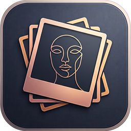
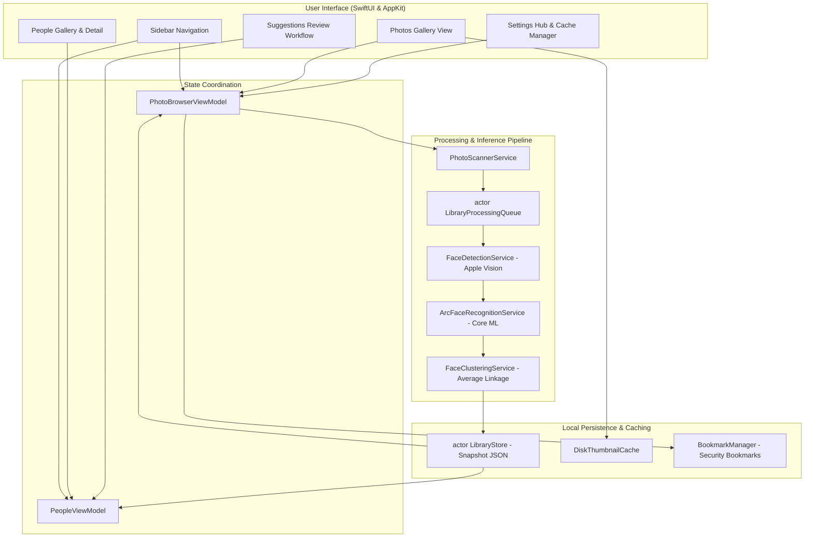

# KeepSake

<p align="center">
  
</p>

<p align="center">
  <strong>Private, local-first macOS photo organization powered by on-device face recognition.</strong>
</p>

<p align="center">
  
  
  
  
  
</p>

---

## Overview

**KeepSake** is a native, local-first macOS application that helps you rediscover, browse, and organize your personal photo libraries by the people in them—without uploading a single pixel to the cloud.

Modern cloud photo platforms frequently sacrifice privacy by streaming personal images to external servers for AI indexing. KeepSake takes the opposite approach: all photo scanning, face detection, neural embedding inference, similarity clustering, thumbnail caching, and identity management run strictly on your Mac, leveraging Apple Silicon, Core ML, and the Apple Vision framework.

---

## Screenshots

> *Placeholder: Screenshots of the main application views.*

| Photos Gallery | People Overview |
| :---: | :---: |
| <br>*(Browse original high-res photos with folder scoping)* | <br>*(Confirmed identity gallery with custom cover photos)* |

| Candidate Suggestions Review | Settings Hub |
| :---: | :---: |
| <br>*(Semi-supervised candidate clusters with Cannot-Link enforcement)* | <br>*(Disk thumbnail cache controls and recycle bin management)* |

---

## Key Features

- **Folder-Scoped Browsing**: Select any folder on your Mac via native macOS security-scoped bookmarks. KeepSake scans and displays photos without moving or altering your files.
- **On-Device Face Detection**: Discovers human faces using Apple's native Vision framework (`VNDetectFaceRectanglesRequest`), filtering out low-confidence or degenerate crops.
- **Deep Face Recognition Pipeline**: Extracts 512-dimensional normalized facial feature vectors using an on-device ArcFace MobileFaceNet Core ML pipeline.
- **Cannot-Link Safety Invariant**: Mathematically enforces that multiple faces appearing within the same photograph can never be grouped into the same identity cluster.
- **Candidate Suggestion Workflow**: Groups similar unconfirmed faces into candidate identity groups for rapid user confirmation or reassignment.
- **Unassigned Faces Management**: Browse unassigned face crops with single and bulk restoration to candidate suggestions.
- **Two Distinct Recycle Bins**:
  - *False Detections*: Non-face objects or artifacts removed from clustering.
  - *Removed from People*: Valid faces detached from a person profile, eligible for reassignment or restoration.
- **Custom Cover Photos**: Pick any face crop or assign a specific photo as the representative avatar for each confirmed person.
- **Global Identity Memory**: Names and identity profiles persist globally across folder switches, automatically recognizing known individuals when you open new photo directories.
- **Two-Tier Thumbnail Caching**: High-performance in-memory cache coupled with an on-disk JPEG thumbnail cache (`DiskThumbnailCache`) for smooth 60/120 fps scrolling.
- **Native Photo Viewer**: Full-screen photo inspector with zoom, metadata, and a native **Show in Finder** shortcut (`NSWorkspace.shared.activateFileViewerSelecting`).
- **100% Private & Non-Destructive**: Original images are accessed strictly read-only. No telemetry, no third-party network requests, and zero cloud uploads.

---

## Architecture & Data Flow

KeepSake is built in Swift using Structured Concurrency, actor isolation, and clean separation of concerns:



### Core Architecture Layers

1. **User Interface (SwiftUI & AppKit)**: Reactive macOS interface with dedicated views for Photos, People, Suggestions, Recycle Bin, and Settings.
2. **Actor-Isolated Snapshot Store (`LibraryStore`)**: Manages atomic reads and writes of `library_index.json`, tracking photo records, face records, embeddings, and identity profiles.
3. **Processing Queue (`LibraryProcessingQueue`)**: Bounded-concurrency background queue with dirty-checking (categorizes files as `NEW`, `CHANGED`, `UNCHANGED`, or `REMOVED`).
4. **Computer Vision & Inference**:
   - `FaceDetectionService`: Detects facial bounding boxes and landmarks via Vision.
   - `ArcFaceRecognitionService`: Crops, aligns (112×112 RGB), normalizes $[-1.0, 1.0]$, and extracts 512-D hyperspherical embeddings via Core ML.
5. **Clustering & Identity (`IdentityService`, `FaceClusteringService`)**: Pairwise cosine distance matrix computation, average-linkage clustering, centroid updates, and strict Cannot-Link conflict resolution.

---

## Technology Stack

| Component | Technology | Role |
|---|---|---|
| **Language** | Swift 5.9+ / Swift 6 Language Mode | Core application logic and concurrency |
| **User Interface** | SwiftUI & AppKit | Native macOS interface, windows, and menus |
| **Concurrency** | Swift Structured Concurrency | Actors (`LibraryStore`, `LibraryProcessingQueue`), async/await, Task groups |
| **Face Detection** | Apple Vision Framework (`VNImageRequestHandler`) | Bounding box localization |
| **Face Recognition** | Apple Core ML & Accelerate (vDSP) | Neural inference and vector L2-normalization |
| **Persistence** | Foundation JSON & Atomic File I/O | Safe on-disk snapshot serialization |
| **Filesystem Access** | AppKit & Security-Scoped Bookmarks | Sandboxed access to user-selected folders |
| **External Packages** | **None** | Zero external dependencies; 100% native Apple frameworks |

---

## Face-Recognition Model & Licensing

KeepSake's facial recognition pipeline is designed around the **MobileFaceNet** architecture trained with **ArcFace (Additive Angular Margin Loss)**:

- **Model Dimensions**: Input tensor $1 \times 3 \times 112 \times 112$ float32; output feature vector $1 \times 512$ float32.
- **Evaluated Checkpoint**: The project evaluates the official InsightFace `buffalo_s` (`w600k_mbf.onnx`) checkpoint converted to Apple Core ML (`buffalo_s.mlmodelc`).
- **Numerical Parity**: Tested at **0.999986 cosine similarity** between the ONNX source and Core ML FP16 representations.

### Model Redistribution & Licensing Policy

> [!IMPORTANT]
> **Pretrained Model Weights Licensing**: Pretrained weights originating from the InsightFace `buffalo_s` / MS1MV3 dataset are distributed by their original authors for **non-commercial academic and personal research only**.
>
> To comply with licensing guidelines and maintain repository safety:
> 1. Raw binary model weights (`*.mlmodelc/`, `*.onnx`, `*.bin`) are **excluded from Git tracking** via `.gitignore`.
> 2. The codebase includes a fully deterministic fallback pipeline (`Legacy Synthetic 2D-DCT Fallback`) so the application builds, runs, and passes all test suites even without binary model weights present.
> 3. For personal testing with the neural model, developers can acquire and compile the Core ML program locally as documented in [`V3_MODEL_INTEGRATION_REPORT.md`](file:///Users/vikramaditya/Disk/Projects/KeepSake/V3_MODEL_INTEGRATION_REPORT.md).
> 4. Future commercial distributions will use an open-weights architecture trained exclusively on permissive datasets (such as CASIA-WebFace or DigiFace-1M under Apache 2.0 / MIT).

---

## Privacy & Data Handling

KeepSake was engineered from inception to protect user privacy:

- **Strictly Local Processing**: All detection, embedding generation, and grouping execute locally on your hardware.
- **Zero Cloud Uploads**: Photos, metadata, names, and face embeddings are never transmitted to external servers.
- **Non-Destructive**: Original photo files are opened in read-only mode. KeepSake never modifies, renames, moves, or deletes original photos.
- **User-Controlled Folders**: Only folders explicitly granted access by the user through macOS Open panels are indexed.
- **Segregated Storage**: Persistent library metadata is saved in Application Support, keeping application data cleanly separate from your photo storage.

---

## Requirements

- **Operating System**: macOS 14.0 (Sonoma) or later.
- **Architecture**: Apple Silicon (M1/M2/M3/M4) recommended for Apple Neural Engine acceleration. Intel Macs running macOS 14.0+ are supported via CPU/GPU.
- **Build Tools**: Xcode 15.0 or later (Swift 5.9+).

---

## Build & Test Instructions

### 1. Clone the Repository

```bash
git clone https://github.com/vikramaditya7z/keepsake-f.git
cd keepsake-f
```

### 2. Build the Application

Build the Debug configuration using `xcodebuild`:

```bash
xcodebuild \
  -project KeepSake.xcodeproj \
  -scheme KeepSake \
  -configuration Debug \
  -derivedDataPath ./build/DerivedData \
  build
```

The compiled application bundle will be located at:
`build/DerivedData/Build/Products/Debug/KeepSake.app`

### 3. Run the Test Suite

Build the test bundle and execute the full test suite (216 automated tests covering concurrency, recovery, Cannot-Link constraints, clustering, and UI state):

```bash
# 1. Build the test bundle
xcodebuild \
  -project KeepSake.xcodeproj \
  -scheme KeepSakeTests \
  -configuration Debug \
  -derivedDataPath ./build/DerivedData \
  build

# 2. Execute unit tests
xcrun xctest build/DerivedData/Build/Products/Debug/KeepSake.app/Contents/PlugIns/KeepSakeTests.xctest
```

---

## Project Structure

```
KeepSake/
├── App/
│   └── KeepSakeApp.swift              # App entry point, menu commands, and scene configuration
├── Models/
│   ├── DetectedFace.swift            # Face geometry and bounding box types
│   ├── FaceEmbedding.swift           # Embedding vector structures
│   ├── FaceGroup.swift               # Candidate cluster and person identity models
│   ├── PersistedModels.swift         # Serializable snapshot models (v1/v2 schema)
│   ├── PhotoItem.swift               # In-memory photo item representation
│   └── UserFacingError.swift         # User-presentable error types
├── Services/
│   ├── ArcFaceRecognitionService.swift # Core ML MobileFaceNet inference service
│   ├── BookmarkManager.swift         # Security-scoped URL persistence
│   ├── DiskThumbnailCache.swift      # Two-tier disk thumbnail caching
│   ├── FaceClusteringService.swift   # Average-linkage clustering & Cannot-Link enforcement
│   ├── FaceDetectionService.swift    # Apple Vision face detection service
│   ├── FolderMonitorService.swift    # FSEvents folder observation service
│   ├── IdentityService.swift         # Multi-folder identity reconciliation & linking
│   ├── LibraryProcessingCoordinator.swift # End-to-end scanning & processing coordinator
│   ├── LibraryProcessingQueue.swift  # Actor-isolated bounded background worker queue
│   ├── LibraryStore.swift            # Actor-isolated JSON snapshot persistence
│   └── ThumbnailLoader.swift         # Asynchronous image and thumbnail loader
├── ViewModels/
│   ├── PeopleViewModel.swift         # People gallery, suggestion review & identity view model
│   └── PhotoBrowserViewModel.swift   # Photo gallery, folder state & scanner view model
├── Views/
│   ├── ContentView.swift             # Main split-view navigation shell
│   ├── PhotoDetailView.swift         # Full-screen photo inspector with Show in Finder
│   ├── PhotoGridView.swift           # Lazy photo grid with dynamic scaling
│   ├── SettingsView.swift            # Settings hub and cache controls
│   ├── WelcomeView.swift             # Initial folder selection welcome state
│   ├── People/                       # People gallery, detail, cards, and sheets
│   └── Suggestions/                  # Candidate suggestion review queue
└── Resources/
    ├── Assets.xcassets               # App icons and accent colors
    └── Info.plist                    # Bundle metadata configuration
```

---

## Known Limitations

- **Face Crop Resolution**: Vision detection performs best on faces with dimensions $\ge 40 \times 40$ pixels; very distant background faces may not be registered.
- **Model Licensing**: The evaluated `buffalo_s` weights are restricted to non-commercial evaluation. A permissively licensed open model will be integrated for commercial releases.
- **Initial Library Scan**: The initial pass on collections with tens of thousands of images is compute-intensive; subsequent launches are instant due to hash-based dirty checking.

---

## Roadmap

- [ ] Standalone signed and notarized `.dmg` release distribution.
- [ ] Integration of an Apache-2.0 / MIT licensed face recognition model trained on synthetic or open datasets.
- [ ] EXIF-based temporal grouping and event co-occurrence clustering.
- [ ] Video file scanning for keyframe face indexing.
- [ ] Performance profiling and memory optimizations for libraries exceeding 100,000 photos.

---

## Contributing

Contributions, bug reports, and suggestions are welcome:

1. **Issues**: Report bugs or feature requests via GitHub Issues with reproducible steps and macOS version details.
2. **Pull Requests**:
   - Fork the repository and create a feature branch.
   - Ensure all 216 existing automated tests pass (`xcrun xctest ...`).
   - Add regression tests for any new functionality or bug fixes.
   - Maintain the 100% local-first, zero-telemetry architectural invariant.

---

## License & Acknowledgments

- **Application Code**: KeepSake source code is currently proprietary / all rights reserved pending formal open-source license selection.
- **Machine Learning Checkpoints**: MobileFaceNet / ArcFace algorithms developed by the [InsightFace Project](https://github.com/deepinsight/insightface). Checkpoint weights retain their authors' non-commercial academic licensing.
- **Apple Frameworks**: Built using Apple Vision, Core ML, Accelerate, and SwiftUI.
