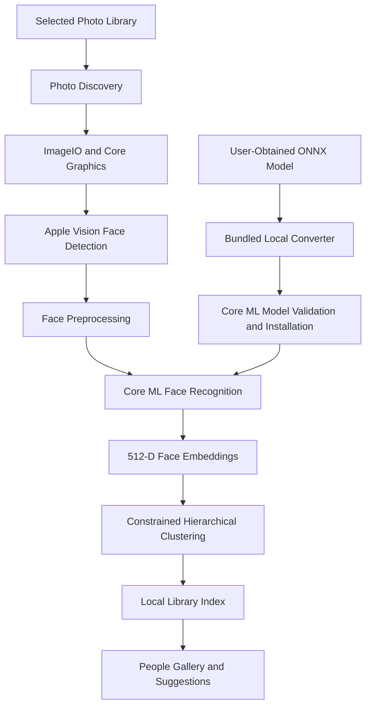

# KeepSake 📸

> **Native, private, on-device face recognition and photo organization for macOS.**

KeepSake organizes personal photo libraries by detecting faces, generating neural face embeddings, and grouping recurring identities directly on your Mac. Built with Swift, SwiftUI, Apple Vision, and Core ML, it brings intelligent photo organization to macOS without relying on cloud-based face recognition.

---

# 🧠 Model Setup — Read This First

**KeepSake requires a compatible face-recognition model to perform neural face recognition and organize people across your photos.**

The model setup popup may not appear automatically on first launch. If you don't see it, you can access model configuration through **Settings → Model**.

KeepSake supports two model setup methods. Most users should start with Option A.

## Option A — Automatic ONNX-to-Core ML Conversion (Recommended)

KeepSake includes a local model converter, so you don't need to set up a separate Python environment.

### Step 1: Download the model

1. Open the official [InsightFace v0.7 release page](https://github.com/deepinsight/insightface/releases/tag/v0.7).
2. Download `buffalo_s.zip`.
3. Extract the archive.
4. Locate the file named `w600k_mbf.onnx` inside the extracted files.

**Important:** Select the `w600k_mbf.onnx` file, not the ZIP archive or another model file.

### Step 2: Open model settings

1. Launch KeepSake.
2. Open **Settings** using `⌘ + ,` (Command + Comma).
3. Navigate to the **Model** tab.
4. Look for the available model setup or ONNX import controls.

If the Model Setup popup appears automatically, you can use the same workflow there.

### Step 3: Convert and install the model

1. Choose the ONNX model selection option, if available.
2. Select the extracted `w600k_mbf.onnx` file.
3. Allow KeepSake to convert the model locally.
4. Wait for validation, Core ML compilation, and installation to finish.

KeepSake uses its bundled `keepsakemodelconverter` helper for the conversion workflow. The expected model input is `1 × 3 × 112 × 112`, with a 512-dimensional embedding output.

The compiled model is installed under:

`~/Library/Application Support/KeepSake/Models/`

Once installation completes successfully, KeepSake can use the model for face recognition.

## Option B — Import an Existing Core ML Model

If you already have a compatible compiled Core ML model:

1. Open KeepSake Settings using `⌘ + ,`.
2. Navigate to the **Model** tab.
3. Choose **Import Core ML Model…**, if available.
4. Select your compatible `.mlpackage` or `.mlmodelc` model.
5. Follow any validation or installation prompts.

The imported model must be compatible with KeepSake's expected input dimensions and 512-dimensional embedding output.

## Model setup troubleshooting

| Problem | What to do |
|---|---|
| The setup popup never appears | Open Settings with `⌘ + ,` and navigate to Model. |
| The ONNX file isn't accepted | Make sure you extracted `buffalo_s.zip` and selected `w600k_mbf.onnx`. |
| Conversion fails | Verify the model file is complete and compatible. Check the error message before retrying. |
| The model isn't detected after installation | Check whether `~/Library/Application Support/KeepSake/Models/active_model.mlmodelc` exists. |
| No model setup controls appear in Settings | Check the installed app's version and consult the [GitHub Issues page](https://github.com/vikramaditya7z/keepsake-f/issues). |

**Licensing:** InsightFace pretrained weights are third-party research artifacts. You must obtain them independently and comply with the applicable license. KeepSake does not distribute the pretrained `w600k_mbf.onnx` weights.

---

# 📦 Download and Install

Download KeepSake for macOS from the official sources:

- **[Download the latest KeepSake DMG](https://github.com/vikramaditya7z/keepsake-f/releases/latest)**
- [View all GitHub releases](https://github.com/vikramaditya7z/keepsake-f/releases)
- [Browse the source code](https://github.com/vikramaditya7z/keepsake-f)

### Installation

1. Download `KeepSake.dmg`.
2. Double-click the downloaded file.
3. Drag `KeepSake.app` into the Applications folder shortcut.
4. Eject the mounted disk image.
5. Open KeepSake from your Applications folder.
6. Complete the model setup described above.
7. Select a folder containing your photos to begin indexing.

---

# 🔐 macOS Security Warning

KeepSake is currently distributed without Apple Developer ID signing and notarization. macOS may therefore display a warning when you first open the downloaded app.

This warning does not establish whether an application is safe or unsafe. Apple has not notarized this release.

Read Apple's guidance: [Safely open apps on your Mac](https://support.apple.com/en-in/102445).

### If macOS blocks KeepSake

If you downloaded the application from the official repository and have verified that it is the expected release, you can try the following:

**Method 1 — Privacy & Security**

1. When the warning appears, click **Done** or **Cancel**.
2. Open **Apple menu → System Settings → Privacy & Security**.
3. Scroll to the Security section.
4. If KeepSake appears as a blocked application, select **Open Anyway**.
5. Authenticate and confirm only if you trust the application.

**Method 2 — Finder**

1. Open Finder and navigate to Applications.
2. Control-click `KeepSake.app`.
3. Select **Open**.
4. Review any confirmation before proceeding.

The available options depend on your macOS version and the specific warning.

**Important:** If macOS reports that the application is damaged or explicitly identifies a malware threat, stop and investigate. Do not disable Gatekeeper globally or indiscriminately remove security attributes from downloaded files.

---

# ✨ Key Features

- **Local-first processing:** Face detection, embedding generation, clustering, and indexing run locally on your Mac.
- **Native macOS experience:** Built using Swift and SwiftUI.
- **Neural face recognition:** Generates 512-dimensional face embeddings using a compatible Core ML recognition model.
- **People gallery:** Browse candidate identity groups and inspect representative faces.
- **Identity suggestions:** Review potential matches and correct groupings.
- **Constrained clustering:** Prevents two distinct faces detected in the same photo from being assigned to the same person cluster.
- **Persistent indexing:** Stores photo metadata, embeddings, and grouping information locally.
- **Memory-conscious processing:** Uses bounded caching, coordinated cancellation, batching, and reduced temporary allocations.
- **Sharp thumbnails:** Image orientation and thumbnail resolution are handled for reliable photo browsing.
- **Local model conversion:** Converts a compatible ONNX model into a format usable by Core ML through the bundled helper.

---

# 🖼️ How KeepSake Works

KeepSake processes a selected photo library through several stages.

1. **Photo discovery:** Finds supported image files in the selected directory.
2. **Face detection:** Uses Apple Vision to identify face locations.
3. **Preprocessing:** Prepares detected face regions for neural inference.
4. **Embedding generation:** Uses Core ML to produce a 512-dimensional numerical representation of each face.
5. **Similarity comparison:** Compares face embeddings using cosine similarity.
6. **Constrained clustering:** Groups likely matches using hierarchical clustering and cannot-link constraints.
7. **Persistence:** Saves indexing results in a local library index.
8. **Review and organization:** Lets users browse people and review candidate matches.

Clustering identifies likely matches; it does not guarantee that every grouping is correct. Users remain responsible for reviewing uncertain identities.

---

# 🏗️ Architecture

KeepSake uses a modular, service-oriented Swift architecture.



### Main technologies

| Component | Technology |
|---|---|
| Language | Swift |
| Interface | SwiftUI |
| Face detection | Apple Vision |
| Image processing | ImageIO and Core Graphics |
| Face recognition | Core ML, MobileFaceNet/ArcFace-style model |
| Model conversion | ONNX, onnx2coreml, coremltools |
| Similarity | Cosine similarity |
| Clustering | Constrained hierarchical average-linkage clustering |
| Persistence | Local JSON index with atomic snapshots |
| Caching | Memory-bounded and disk-backed caches |
| Concurrency | Swift async/await and coordinated processing |

---

# 🔒 Privacy and Local Data Storage

KeepSake is designed to process personal photos locally rather than upload them to a cloud-based face-recognition service.

The application stores its library index, installed model, preferences, and cached thumbnails in standard macOS application directories.

| Component | Location |
|---|---|
| Library index | `~/Library/Application Support/KeepSake/library_index.json` |
| Installed model | `~/Library/Application Support/KeepSake/Models/` |
| Thumbnail cache | `~/Library/Caches/com.keepsake.KeepSake/Thumbnails/` |
| Preferences | `~/Library/Preferences/com.keepsake.KeepSake.plist` |

The original photos remain in their selected locations. KeepSake's indexing workflow does not require moving or re-encoding the originals.

Face embeddings and identity-group information are sensitive derived data. Protect access to your Mac and its local application data accordingly.

---

# 💻 System Requirements

- **Operating system:** macOS 14.0 (Sonoma) or later, as specified by the current project configuration.
- **Architecture:** Universal application targeting Apple Silicon (`arm64`) and Intel (`x86_64`).
- **Recommended hardware:** Apple Silicon for access to Apple Neural Engine acceleration where supported.
- **Model requirement:** A compatible Core ML recognition model, installed through the model setup workflow.

---

# 🛠️ Developer Setup

## 1. Clone the repository

```bash
git clone https://github.com/vikramaditya7z/keepsake-f.git
cd keepsake-f
```

## 2. Build the Release application

```bash
xcodebuild \
  -project KeepSake.xcodeproj \
  -scheme KeepSake \
  -configuration Release \
  -derivedDataPath ./build/DerivedData \
  build
```

The resulting application should be located at:

`build/DerivedData/Build/Products/Release/KeepSake.app`

**Packaging note:** The model converter may require the project's embedding script to be run against the Release app after building. Follow the current release packaging procedure and verify the final bundle before distributing it.

## 3. Run the test suite

Use the project's configured test scheme:

```bash
xcodebuild \
  -project KeepSake.xcodeproj \
  -scheme KeepSake \
  -destination 'platform=macOS' \
  -derivedDataPath ./build/DerivedData \
  test
```

Tests should use isolated temporary storage rather than modifying a production photo library.

## 4. Create the DMG

Use the repository's existing packaging script:

```bash
bash build/scripts/create_dmg.sh
```

The expected output is:

`dist/KeepSake.dmg`

Verify that the resulting disk image contains the complete Release app and required converter resources before distributing it.

---

# 📜 Licensing and Acknowledgments

- **KeepSake application code:** MIT License. See [LICENSE](LICENSE).
- **Third-party conversion dependencies:** See [THIRD_PARTY_NOTICES.md](THIRD_PARTY_NOTICES.md) for dependency licenses and notices.
- **InsightFace:** The upstream project provides the recognition model artifacts. Users must independently obtain compatible pretrained weights and comply with the applicable license.
- **Model weights:** KeepSake does not bundle or distribute the pretrained `buffalo_s` or `w600k_mbf.onnx` weights.

Official upstream project: [InsightFace](https://github.com/deepinsight/insightface).

---

# 🐛 Troubleshooting and Support

If you encounter a problem:

1. Check the relevant setup or troubleshooting section above.
2. Verify that you're using the official KeepSake download.
3. Confirm that your model is compatible and installed correctly.
4. Review existing reports or open an issue on [GitHub Issues](https://github.com/vikramaditya7z/keepsake-f/issues).

When reporting a bug, include your macOS version, Mac architecture, the relevant error message, and the steps needed to reproduce the issue. Do not attach private photos or your personal library database.

---

**KeepSake — your photo library, organized locally.** 📸
